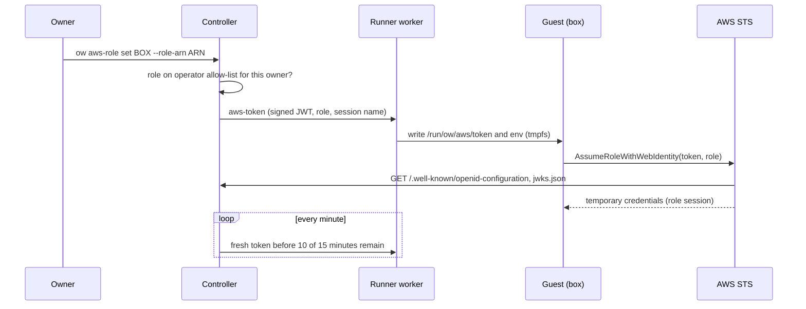

# Per-box AWS access

**Implemented in 0.9.37, off by default.** A box can be given one IAM role. Programs
in it then get short-lived credentials for that role through the standard AWS
credential chain (SDKs and the AWS CLI); no AWS access key is stored in the box or
on its disk, and the controller and runners hold no AWS credentials for it. The
design and its limits are recorded in [ADR 0008](adr/0008-per-box-aws-web-identity.md);
it is the active web-identity mode of the [CredentialBroker](CREDENTIAL_BROKER.md).

**Not yet verified against real AWS.** Tests cover token claims, signatures,
rotation, incarnation binding, allow-list enforcement and the SDK credential chain
against a mock STS. Creating an IAM OIDC provider and role in an AWS account is
the consumer's acceptance step, described at the end.

## How it works



1. The controller signs an ES256 identity token for the box:

   | Claim | Value |
   | --- | --- |
   | `iss` | the operator's issuer URL |
   | `sub` | `owner/<owner login email, lower case>/box/<box ID>` |
   | `aud` | `sts.amazonaws.com` |
   | `iat`, `nbf`, `exp` | issued now, valid for 15 minutes |
   | `jti` | random, per token |
   | `ow_box`, `ow_owner`, `ow_generation` | box ID, owner, box generation (informational) |

   The box ID is the `id` that `ow inspect` shows; `aws_role.subject` there is the
   exact `sub`.
2. The worker writes it to `/run/ow/aws/token` in the running guest, and
   `/run/ow/aws/env` with `AWS_ROLE_ARN`, `AWS_WEB_IDENTITY_TOKEN_FILE` and
   `AWS_ROLE_SESSION_NAME`. `/run` is in RAM. Login shells, `ow exec`, SSH and
   terminal sessions (through `/etc/profile.d/ow-aws.sh`, also sourced from
   `/etc/bash.bashrc` where it exists) export these variables. A systemd service can
   use `EnvironmentFile=-/run/ow/aws/env`. On developer images the files belong to
   `dev`; on images without one (Alpine) `ow exec` reads the env file before your
   command, and terminals get the variables from the guest agent.
3. The SDK calls `AssumeRoleWithWebIdentity` itself and re-reads the token file
   whenever it refreshes credentials. The role session name is `ow-` plus a hash of
   the box ID and generation, so each incarnation shows separately in CloudTrail.
4. The controller re-issues the token once less than 10 of its 15 minutes remain,
   and at once after an attach, a move or a wake to another placement. A cold stop
   and start empties `/run`; the worker remembers which VM process got the token,
   so the next pass (each minute) delivers it again. Refreshing never wakes a
   hibernated box and does not keep a box from idle hibernation; a box resumed
   from hibernation keeps the token in its restored RAM and gets a fresh one when
   that one is old.

## For box owners

```sh
ow aws-role set demo --role-arn arn:aws:iam::111122223333:role/ow-demo-reader
ow inspect demo        # "aws_role": role, state, token expiry, generation, subject
ow exec demo aws sts get-caller-identity
ow aws-role unset demo
```

In the dashboard, select the machine and choose **AWS role**; only the roles the
operator allows for you are offered. The machine details show the role and until
when its current token is valid, with **Detach**.

- Only the owner or a teammate with the `admin` share role can set or unset it.
- `state` is `active` (token delivered, `token_expires_at` in Unix seconds),
  `pending` (the box is not running; it gets one when it runs), `error` (not
  delivered: an old runner, or the role was removed from the allow-list) or
  `inactive` (the box changed owner; its new owner must attach a role).
- **Forks start without a role.** A full-state fork's RAM holds a copy of its
  parent's token files. Within about a minute the controller removes them and
  moves the parent to a new generation with a new signing key; the copied token
  stops verifying once AWS re-reads the JWKS (and never lasts past its 15 minutes).
  The same happens to old tokens after a move or a wake on another runner.
  Parked or transferring boxes have their keys withdrawn at the next refresh;
  re-attaching withdraws the old key immediately even while parked. Cleanup of
  role-less boxes runs again after a restore or start by the owner or an admin.
- **A new owner starts without a role.** An attachment belongs to the owner who
  made it. If a box changes owner, it gets no new tokens and its files are removed
  at the next pass; the new owner, or an admin, attaches a role again.
- Unset, owner change, allow-list removal and deleting the box withdraw the box's
  signing key from the JWKS and remove the files: its tokens, copies included, stop
  verifying once AWS re-reads the JWKS (served with `max-age=60`; AWS's own cache
  time is not documented and not verified here; at most 15 minutes in any case).
  This does **not** revoke AWS sessions already issued (one hour by default). Use short role session durations and
  [revoke sessions](https://docs.aws.amazon.com/IAM/latest/UserGuide/id_roles_use_revoke-sessions.html)
  in IAM when it matters.
- Guest root can read the token: anyone with a shell in the box can act as its
  role. Sharing a box shares that.

## For operators

### 1. Turn it on

Write `aws-identity.json` next to the catalog in the controller's data directory
(owner-only, like the other private files):

```json
{
  "issuer": "https://ow.example.com",
  "allowed_roles": [
    {"role_arn": "arn:aws:iam::111122223333:role/ow-demo-reader"},
    {"role_arn": "arn:aws:iam::111122223333:role/ow-alice-deploy", "owners": ["alice@example.com"]}
  ]
}
```

- `issuer`: the public `https://` URL (no port, query or trailing slash; a path is
  allowed) where AWS can fetch the discovery document. It is the `iss` of every token.
- `allowed_roles`: the only role ARNs anyone may attach, at most 100. At most 99
  boxes can have a role at once (AWS reads up to 100 EC keys from a JWKS). Exact ARNs, no
  wildcards. `owners` limits a role to boxes owned by those login emails; without
  it any user of this controller may attach it to their boxes.

Restart the dashboard/gateway once so the refresher starts (the allow-list itself
is re-read on every request and pass, so later edits need no restart). The first
signing keys live in the owner-only `aws-identity-keys/` directory beside it: one
per box generation plus an anchor key that never signs. They need no backup: a
controller restored without them creates new keys, and boxes hold tokens that no
longer verify until their next refresh (within about 6 minutes). Removing a role from the list,
or deleting `aws-identity.json`, refuses new attachments at once and clears the
boxes' token files at the next pass.

Runners must run this release (worker capability `aws_identity_v1`, a class-2
worker upgrade; see [upgrades](UPGRADES.md)). Mac runners are not supported.

### 2. Publish the issuer documents

The gateway answers, without sign-in:

- `GET <issuer>/.well-known/openid-configuration`
- `GET <issuer>/.well-known/jwks.json`

when the issuer is the gateway's own hostname. With Cloudflare Access in front,
add a **Bypass** policy for exactly those two paths, or AWS will be sent to the
login page. Alternatively publish the two documents at another HTTPS URL (for
example a static bucket website) and use that URL as the issuer: fetch them from
the controller host with
`curl -H 'Host: <gateway hostname>' http://127.0.0.1:<gateway port>/.well-known/jwks.json`
and copy them again after replacing the key. The URL must present a certificate
from a public CA; AWS then needs no thumbprint. A tailnet-only gateway is not
reachable by AWS: publish the documents elsewhere and use that URL.

### 3. Create the IAM OIDC provider (consumer's AWS account)

Not run by this project. In the account that owns the roles:

```sh
aws iam create-open-id-connect-provider \
  --url https://ow.example.com \
  --client-id-list sts.amazonaws.com
```

The URL must match `issuer` exactly. One provider serves every box of this
controller.

### 4. Create each role with a trust policy pinned to boxes

Trust one box (copy `aws_role.subject` from `ow inspect`):

```json
{
  "Version": "2012-10-17",
  "Statement": [{
    "Effect": "Allow",
    "Principal": {"Federated": "arn:aws:iam::111122223333:oidc-provider/ow.example.com"},
    "Action": "sts:AssumeRoleWithWebIdentity",
    "Condition": {
      "StringEquals": {
        "ow.example.com:aud": "sts.amazonaws.com",
        "ow.example.com:sub": "owner/alice@example.com/box/m-0123456789abcdef01234567"
      }
    }
  }]
}
```

or every box of one owner:

```json
"Condition": {
  "StringEquals": {"ow.example.com:aud": "sts.amazonaws.com"},
  "StringLike": {"ow.example.com:sub": "owner/alice@example.com/box/*"}
}
```

Never trust the provider without a `sub` condition: the allow-list stops users
picking arbitrary roles, but the trust policy is what AWS enforces. A per-box `sub`
stays valid across moves, hibernation and renames; a fork has a new box ID and does
not match.

Give the role only what the box needs, for example read access to one bucket
prefix, and a short maximum session duration:

```json
{
  "Version": "2012-10-17",
  "Statement": [
    {"Effect": "Allow", "Action": "s3:ListBucket", "Resource": "arn:aws:s3:::example-data",
     "Condition": {"StringLike": {"s3:prefix": "demo/*"}}},
    {"Effect": "Allow", "Action": "s3:GetObject", "Resource": "arn:aws:s3:::example-data/demo/*"}
  ]
}
```

```sh
aws iam update-role --role-name ow-demo-reader --max-session-duration 3600
```

Do not grant IAM administration, `sts:AssumeRole` into broader roles, or secret
reads the box does not need. Then add the role ARN to `allowed_roles`.

## Validation

```sh
cargo test --locked -p ow-core --lib web_identity aws_token
cargo test --locked -p ow-core --test web_identity_chain
cargo test --locked -p ow --bin ow aws_identity      # Linux
cd e2e && npx playwright test aws.spec.mjs            # Linux
```

`web_identity_chain` writes the guest files, reads them back through a shell, and
lets the AWS SDK for Rust's default chain call a loopback mock STS: it checks the
`AssumeRoleWithWebIdentity` form (role, session name, token) and that a refreshed
token file is what the next call presents. CI also runs it as root in an Ubuntu
container with a `dev` user, reading the variables through dev's login shell.

## Real-AWS acceptance (pending, consumer)

In a sandbox account, with explicit approval for the account and its spend:

1. Publish the issuer (step 2) and check both URLs from outside with `curl`.
2. Create the OIDC provider and one test role trusted for one test box's `sub`,
   permitted only `sts:GetCallerIdentity` (no permission policy needed) or one
   test bucket prefix.
3. `ow aws-role set` on the test box; `ow exec BOX aws sts get-caller-identity`
   shows the assumed role and an `ow-…` session name.
4. A fork of it, and a second box with the role attached, are refused by STS
   (`sub` mismatch); after `unset`, a new shell has no role variables.
5. Record versions, region and the CloudTrail `AssumeRoleWithWebIdentity` events
   (no tokens or credentials) in the consumer's private notes.
