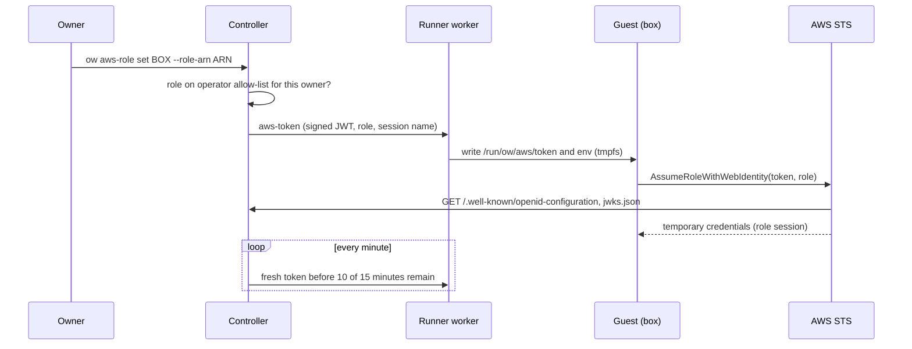

# Per-box AWS access

A box can be given one IAM role. Programs in it then get short-lived credentials for
that role through the standard AWS credential chain (the AWS CLI, every SDK,
Terraform); no AWS access key is stored in the box or on its disk. Off by default.
There are two modes, chosen by the operator in `aws-identity.json` on the controller:

| | Metadata mode (0.9.42) | Web-identity mode (0.9.37, the default) |
| --- | --- | --- |
| Where the controller runs | on EC2 with an instance role | anywhere |
| What the box sees | EC2's instance metadata at `169.254.169.254`, nothing in the box | a token file and `AWS_ROLE_ARN`/`AWS_WEB_IDENTITY_TOKEN_FILE` in login shells |
| Who calls STS | the controller (`AssumeRole`, its instance role) | the box's SDK (`AssumeRoleWithWebIdentity`) |
| AWS setup | roles under `/ow-box/` trusting the controller's role | a public issuer URL, an IAM OIDC provider, roles trusting it |
| The user's own `~/.aws/credentials` | always wins (instance metadata is last in every chain) | loses to the role in botocore/CLI, Go v2/Terraform and Java v2 |
| Limit | none | 99 boxes with a role per controller |

**Use metadata mode on an AWS-hosted controller.** Its design is
[ADR 0010](adr/0010-per-box-aws-metadata-endpoint.md); web identity's is
[ADR 0008](adr/0008-per-box-aws-web-identity.md). Both are active modes of the
[CredentialBroker](CREDENTIAL_BROKER.md).

**Not yet verified against real AWS.** Tests cover the metadata endpoint (IMDSv2,
box binding, limits), the worker network policy in an isolated network namespace,
the controller's STS request against a mock STS signed with instance-metadata
credentials, every withdrawal path, and botocore's credential chain against the
real endpoint; web identity's tokens, signatures and SDK chain against a mock STS.
Creating the roles in an AWS account is the consumer's acceptance step, described
at the end.

## Metadata mode

```mermaid
sequenceDiagram
    participant O as Owner
    participant C as Controller (EC2)
    participant S as AWS STS
    participant W as Runner worker
    participant G as Guest (box)
    O->>C: ow aws-role set BOX --role-arn ARN
    C->>C: role on the operator allow-list for this owner?
    C->>W: aws-creds (wait for this generation)
    C->>S: AssumeRole(ARN, tags ow-box, ow-owner; source identity) as the instance role
    S-->>C: credentials, one hour
    C->>W: aws-creds (credentials; kept in memory only)
    W-->>C: credentials stored
    C-->>O: attached, active
    G->>W: PUT /latest/api/token, GET .../security-credentials/ROLE at 169.254.169.254
    W-->>G: credentials, as EC2 answers
    loop every minute
        C->>S: new session once less than 30 minutes remain
    end
```

1. The controller assumes the attached role with its own EC2 instance role,
   read from instance metadata only (never `AWS_*` variables or `~/.aws` on the
   controller host). The session name and source identity are `ow-` plus a hash of
   the box ID and generation, so each incarnation shows separately in CloudTrail;
   the session carries the transitive tags `ow-box` (the box ID `ow inspect` shows)
   and `ow-owner` (the owner's login email, lower case). STS runs with the catalog
   unlocked; credentials for an attachment that changed meanwhile are dropped.
   For a running or hibernated box, `ow aws-role set` waits for STS and the runner's
   credential acknowledgement before reporting success. A failed STS call, failed
   delivery or concurrent attachment change returns an error, never an early success.
   The saved attachment can remain pending for the refresher to retry; inspect its
   status before retrying. Stopped or parked boxes attach as `pending`, without a wake.
2. The runner's worker keeps the credentials in memory, never on disk or in the
   box, and answers the box at `169.254.169.254:80`, which its network policy
   redirects to one listener in the worker's network namespace. The box is
   identified by its network address, which the worker binds to its own virtual
   interface: a box cannot pose as another. IMDSv2 only (a token first, as on EC2
   with tokens required). Requests through a proxy (`X-Forwarded-For`) are refused,
   and browsers get no CORS access. The runner's own instance metadata is never
   reachable from a box.
3. Answers leave with an IP TTL of 1 by default, so containers inside the box
   (one routed hop further) cannot read the role; `--hop-limit 2` allows them.
4. A box without a role gets `404` at once, so SDKs move on instead of waiting for
   a timeout. If credentials are temporarily missing during an in-progress attach,
   cold start or move, a metadata request waits up to 0.8 s. Successful attachment
   to a live box already has credentials ready and does not depend on that wait.
5. Sessions last one hour and are renewed with 30 minutes left, for hibernated boxes
   too, so a woken box answers at once. A stopped box holds none; it gets them when
   it starts. A move to another runner is a new generation and session; the runner
   it left forgets them.

What programs in the box see:

```sh
TOKEN=$(curl -s -X PUT -H 'X-aws-ec2-metadata-token-ttl-seconds: 300' http://169.254.169.254/latest/api/token)
curl -s -H "X-aws-ec2-metadata-token: $TOKEN" http://169.254.169.254/latest/meta-data/iam/security-credentials/
aws sts get-caller-identity          # assumed-role/ROLE/ow-…
```

Paths answered: `/latest/api/token` (PUT), `/latest/meta-data/iam/security-credentials/`
and `…/ROLE`, `/latest/meta-data/iam/info` (a synthetic
`instance-profile/ow-box/ROLE` ARN, not a real instance profile),
`/latest/meta-data/placement/region` and `…/availability-zone`, and
`/latest/dynamic/instance-identity/document` (region and zone only). Everything
else is `404`.

### Your own credentials still win

Instance metadata is the **last** source in every AWS credential chain. In a box with
a role, `AWS_ACCESS_KEY_ID`/`AWS_SECRET_ACCESS_KEY`, `AWS_PROFILE`, SSO,
`credential_process`, `~/.aws/credentials` and container credentials all come
first; with none of them, the box role is used. `AWS_EC2_METADATA_DISABLED=true`
turns the endpoint off for a shell. When you set no region, SDKs that read it from
instance metadata (the AWS CLI, Go v2, Rust) take the controller's region.

### Limits and revocation

- Detach, re-attach, transfer to another owner and the operator removing the role
  from the allow-list withdraw the runner's credentials before the change is saved.
  If the runner of a running (or hibernated) box with a role cannot be reached,
  transfer and detach are refused until it is back.
- An IMDSv2 token names the role generation it was issued under: after a detach or
  re-attach, programs fetch a new token (every SDK does on `401`). The catalog
  retains the last generation when an attachment is deleted, including on owner
  transfer, so re-attaching cannot make a withdrawn token valid again. This
  history survives controller restarts and applies to both modes.
- **Credentials an SDK already fetched stay valid until they expire (at most one
  hour)**, including copies in the box's RAM, and so in its hibernation snapshot, a
  full-state fork made from it, or a recovery point. To end them at once, revoke
  the role's sessions in IAM (console: the role, **Revoke active sessions**; this
  denies every session issued before now), then let the controller issue new ones,
  or detach first. Stop the box after a detach if what ran in it matters.
- Anyone who can run commands in the box (its owner, `use` and `admin` grantees) can
  use its role.
- Mac runners are not supported.

## Web-identity mode

### How it works



1. The controller signs an ES256 identity token for the box:

   | Claim | Value |
   | --- | --- |
   | `iss` | the operator's issuer URL |
   | `sub` | `owner/<owner login email, lower case>/box/<box ID>` |
   | `aud` | `sts.amazonaws.com` |
   | `iat`, `nbf`, `exp` | issued now, valid for 15 minutes |
   | `jti` | random, per token |
   | `ow_box`, `ow_owner`, `ow_generation` | box ID, owner, box generation (informational) |

   The box ID is the `id` that `ow inspect` shows; `aws_role.subject` there is the
   exact `sub`.
2. The worker writes it to `/run/ow/aws/token` in the running guest, and
   `/run/ow/aws/env` with `AWS_ROLE_ARN`, `AWS_WEB_IDENTITY_TOKEN_FILE` and
   `AWS_ROLE_SESSION_NAME`. `/run` is in RAM. Login shells, `ow exec`, SSH and
   terminal sessions (through `/etc/profile.d/ow-aws.sh`, also sourced from
   `/etc/bash.bashrc` where it exists) export these variables. A systemd service can
   use `EnvironmentFile=-/run/ow/aws/env`. On developer images the files belong to
   `dev`; on images without one (Alpine) `ow exec` reads the env file before your
   command, and terminals get the variables from the guest agent.
3. The SDK calls `AssumeRoleWithWebIdentity` itself and re-reads the token file
   whenever it refreshes credentials. The role session name is `ow-` plus a hash of
   the box ID and generation, so each incarnation shows separately in CloudTrail.
4. The controller re-issues the token once less than 10 of its 15 minutes remain,
   and at once after an attach, a move or a wake to another placement. A cold stop
   and start empties `/run`; the worker remembers which VM process got the token,
   so the next pass (each minute) delivers it again. Refreshing never wakes a
   hibernated box and does not keep a box from idle hibernation; a box resumed
   from hibernation keeps the token in its restored RAM and gets a fresh one when
   that one is old.

## For box owners

```sh
ow aws-role set demo --role-arn arn:aws:iam::111122223333:role/ow-box/demo-reader
ow inspect demo        # "aws_role": role, state, expiry, generation, hop limit
ow exec demo aws sts get-caller-identity
ow aws-role set demo --role-arn ARN --hop-limit 2   # metadata mode: containers in the box too
ow aws-role unset demo
```

In the dashboard, select the machine and choose **AWS role**; only the roles the
operator allows for you are offered. The machine details show the role and until
when its current credentials (or token) are valid, with **Detach**.

- The box owner, a teammate with the `admin` share role, or the configured pool
  administrator can set or unset it. Gateway `pool_admins` uses the catalog-bound
  verified login, as for transfer/fork. The designated host pool owner is also
  admitted by verified subject and catalog ID (`node_owner_subject` /
  `node_owner_user_id`); email headers and request parameters grant no authority. A pool administrator needs no
  share: use `ow aws-role set owner@example.com/box --role-arn ARN` or `unset`.
  Configured pool admins use the dashboard's Pool machines cards; the designated
  host pool owner gets an AWS settings list in host controls. Both show the box's
  role, allowed roles and attach/detach actions, without guest or disk controls.
  The chosen role must still be allowed for the **box owner**.
- `state` is `active` (credentials or token delivered, `token_expires_at` in Unix
  seconds), `pending` (the box is not running, or metadata-mode credentials are on
  their way; it gets them when it runs), `error` (not delivered: an old runner, STS
  refused the role, or the role was removed from the allow-list) or `inactive` (the
  box changed owner; its new owner must attach a role).
- **Forks start without a role**: a fork is a new box. In metadata mode nothing of
  the parent's role reaches it, except what an SDK cached in the RAM it copied
  (valid until it expires, see above). In web-identity mode a full-state fork's RAM holds a copy of its
  parent's token files. Within about a minute the controller removes them and
  moves the parent to a new generation with a new signing key; the copied token
  stops verifying once AWS re-reads the JWKS (and never lasts past its 15 minutes).
  The same happens to old tokens after a move or a wake on another runner.
  Parked or transferring boxes have their keys withdrawn at the next refresh;
  re-attaching withdraws the old key immediately even while parked. Cleanup of
  role-less boxes runs again after a restore or start by the owner or an admin.
- **A new owner starts without a role.** An attachment belongs to the box owner
  at attachment. A transfer ends it: in metadata mode the runner forgets the
  credentials before the transfer is saved; in web-identity mode the box gets no
  new tokens and its files are removed at the next pass; the new owner, or an admin, attaches a role again. Revoked
  attachments retry file cleanup every refresh pass, including after a stopped
  box starts or a snapshot restores copied token files.
- Web-identity mode: unset, owner change, allow-list removal and deleting the box withdraw the box's
  signing key from the JWKS and remove the files: its tokens, copies included, stop
  verifying once AWS re-reads the JWKS (served with `max-age=60`; AWS's own cache
  time is not documented and not verified here; at most 15 minutes in any case).
  This does **not** revoke AWS sessions already issued (one hour by default). Use short role session durations and
  [revoke sessions](https://docs.aws.amazon.com/IAM/latest/UserGuide/id_roles_use_revoke-sessions.html)
  in IAM when it matters.
- Guest root can read the token or credentials: anyone with a shell in the box can
  act as its role. Sharing a box shares that.

## For operators: metadata mode

The controller must run on EC2 with an instance role (the AWS component's Host).

### 1. Let the controller's role assume box roles

With the AWS component, set `boxRoles: true` on the Host. Otherwise give the
controller host's role exactly this, and nothing broader:

```json
{"Effect": "Allow",
 "Action": ["sts:AssumeRole", "sts:TagSession", "sts:SetSourceIdentity"],
 "Resource": "arn:aws:iam::111122223333:role/ow-box/*"}
```

Instance metadata on the controller host is readable by any local process, so these
rights are as safe as that host. Recommended: allow `169.254.169.254` only to root
and the controller's user with a host firewall, and limit who may create roles
under `/ow-box/` (for example a permissions boundary required by an SCP); the
controller cannot enforce either.

### 2. Create each box role under `/ow-box/`

The path is required. Its trust policy trusts only the controller host's role and
pins the owner (and, for a single box, the box) through the session tags the
controller sets; start from [box-role-trust.json](examples/box-role-trust.json):

```json
{"Effect": "Allow",
 "Principal": {"AWS": "arn:aws:iam::111122223333:role/CONTROLLER-HOST-ROLE"},
 "Action": ["sts:AssumeRole", "sts:TagSession", "sts:SetSourceIdentity"],
 "Condition": {"StringEquals": {
   "aws:RequestTag/ow-owner": "alice@example.com",
   "aws:RequestTag/ow-box": "m-0123456789abcdef01234567"}}}
```

`ow-owner` is the owner's login email in lower case; `ow-box` is the `id` that
`ow inspect` shows (it stays across moves, hibernation and renames; a fork has a new
one). Drop the `ow-box` condition for a role every box of that owner may use. Give
the role only what the box needs, as below for web identity; sessions last one hour.

### 3. Turn it on

Write `aws-identity.json` next to the catalog in the controller's data directory
(owner-only):

```json
{
  "mode": "metadata",
  "allowed_roles": [
    {"role_arn": "arn:aws:iam::111122223333:role/ow-box/alice-reader", "owners": ["alice@example.com"]}
  ]
}
```

- Every role must be under `/ow-box/`, in the controller's own account, and list
  its `owners` (login emails); there is no issuer and no 99-box limit.
- The file is the controller's configuration for this feature: it is re-read on
  every request, and an edit wakes the refresher, so turning access on, switching
  modes or changing the allow-list takes effect within seconds, without a restart.
  Removing a role, or the file, refuses new attachments at once and withdraws the
  boxes' credentials at the next pass. Switching back to web identity withdraws the
  credentials runners hold at the next pass; until a runner that was given some is
  reached again, its running boxes cannot be transferred or detached.

### 4. Runners

Runners must run this release: `ow nodes` shows `aws_metadata_v1: true` for each
(a class-2 worker upgrade; see [upgrades](UPGRADES.md)). The controller never sends
credentials to a runner without it.

## For operators: web-identity mode

### 1. Turn it on

Write `aws-identity.json` next to the catalog in the controller's data directory
(owner-only, like the other private files):

```json
{
  "issuer": "https://ow.example.com",
  "allowed_roles": [
    {"role_arn": "arn:aws:iam::111122223333:role/ow-demo-reader"},
    {"role_arn": "arn:aws:iam::111122223333:role/ow-alice-deploy", "owners": ["alice@example.com"]}
  ]
}
```

- `issuer`: the public `https://` URL (no port, query or trailing slash; a path is
  allowed) where AWS can fetch the discovery document. It is the `iss` of every token.
- `allowed_roles`: the only role ARNs anyone may attach, at most 100. At most 99
  boxes can have a role at once (AWS reads up to 100 EC keys from a JWKS). Exact ARNs, no
  wildcards. `owners` limits a role to boxes owned by those login emails; without
  it any user of this controller may attach it to their boxes.

The file is re-read on every request and refresher pass, and an edit wakes the
refresher: no restart is needed. The first
signing keys live in the owner-only `aws-identity-keys/` directory beside it: one
per box generation plus an anchor key that never signs. They need no backup: a
controller restored without them creates new keys, and boxes hold tokens that no
longer verify until their next refresh (within about 6 minutes). Removing a role from the list,
or deleting `aws-identity.json`, refuses new attachments at once and clears the
boxes' token files at the next pass.

Runners must run this release (worker capability `aws_identity_v1`, a class-2
worker upgrade; see [upgrades](UPGRADES.md)). Mac runners are not supported.

### 2. Publish the issuer documents

The gateway answers, without sign-in:

- `GET <issuer>/.well-known/openid-configuration`
- `GET <issuer>/.well-known/jwks.json`

when the issuer is the gateway's own hostname. With Cloudflare Access in front,
add a **Bypass** policy for exactly those two paths, or AWS will be sent to the
login page. Alternatively publish the two documents at another HTTPS URL (for
example a static bucket website) and use that URL as the issuer: fetch them from
the controller host with
`curl -H 'Host: <gateway hostname>' http://127.0.0.1:<gateway port>/.well-known/jwks.json`
and copy them again after replacing the key. The URL must present a certificate
from a public CA; AWS then needs no thumbprint. A tailnet-only gateway is not
reachable by AWS: publish the documents elsewhere and use that URL.

### 3. Create the IAM OIDC provider (consumer's AWS account)

Not run by this project. In the account that owns the roles:

```sh
aws iam create-open-id-connect-provider \
  --url https://ow.example.com \
  --client-id-list sts.amazonaws.com
```

The URL must match `issuer` exactly. One provider serves every box of this
controller.

### 4. Create each role with a trust policy pinned to boxes

Trust one box (copy `aws_role.subject` from `ow inspect`):

```json
{
  "Version": "2012-10-17",
  "Statement": [{
    "Effect": "Allow",
    "Principal": {"Federated": "arn:aws:iam::111122223333:oidc-provider/ow.example.com"},
    "Action": "sts:AssumeRoleWithWebIdentity",
    "Condition": {
      "StringEquals": {
        "ow.example.com:aud": "sts.amazonaws.com",
        "ow.example.com:sub": "owner/alice@example.com/box/m-0123456789abcdef01234567"
      }
    }
  }]
}
```

or every box of one owner:

```json
"Condition": {
  "StringEquals": {"ow.example.com:aud": "sts.amazonaws.com"},
  "StringLike": {"ow.example.com:sub": "owner/alice@example.com/box/*"}
}
```

Never trust the provider without a `sub` condition: the allow-list stops users
picking arbitrary roles, but the trust policy is what AWS enforces. A per-box `sub`
stays valid across moves, hibernation and renames; a fork has a new box ID and does
not match.

Give the role only what the box needs, for example read access to one bucket
prefix, and a short maximum session duration:

```json
{
  "Version": "2012-10-17",
  "Statement": [
    {"Effect": "Allow", "Action": "s3:ListBucket", "Resource": "arn:aws:s3:::example-data",
     "Condition": {"StringLike": {"s3:prefix": "demo/*"}}},
    {"Effect": "Allow", "Action": "s3:GetObject", "Resource": "arn:aws:s3:::example-data/demo/*"}
  ]
}
```

```sh
aws iam update-role --role-name ow-demo-reader --max-session-duration 3600
```

Do not grant IAM administration, `sts:AssumeRole` into broader roles, or secret
reads the box does not need. Then add the role ARN to `allowed_roles`.

## Validation

```sh
cargo test --locked -p ow-core --lib metadata sts aws_
cargo test --locked -p ow-core --lib web_identity aws_token
cargo test --locked -p ow-core --test web_identity_chain
cargo test --locked -p ow --bin ow aws_identity      # Linux
cd e2e && npx playwright test aws.spec.mjs            # Linux
```

Metadata mode:

- `metadata` (worker): IMDSv2 only, `X-Forwarded-For`, `OPTIONS` and bodies refused,
  no CORS header, a token from one box refused at another, after a new VMM start and
  after its role was detached or replaced, headers over 4 KiB refused however they
  arrive,
  the EC2 credential and `iam/info` shapes, an immediate `404` without a role and the
  0.8 s wait for credentials on their way, connection, header and rate limits, the
  hop limit as IP TTL. `runtime` checks that the worker keeps credentials only in
  memory, for hibernated boxes too, and serves them while its runtime lock is held.
- `sts`: the controller's `AssumeRole` request (role, session name, source identity,
  one hour, `ow-box`/`ow-owner` transitive tags, owner in lower case) against a mock
  STS, signed with credentials from a fake instance metadata service in its region;
  STS errors reduced to their code; roles of another account refused before any call.
- `aws_identity::tests::metadata` (controller): STS called with the catalog lock
  released; credentials assumed for an attachment that changed meanwhile (a
  transfer, a re-attach) never delivered; renewal with 30 minutes left, after a
  worker restart, on a move and for hibernated boxes, none for stopped boxes or fork
  children; detach, re-attach, transfer and allow-list removal withdraw the
  runner's copy while the old attachment is still committed (read from another
  catalog connection), and an unreachable runner refuses transfer and detach of a
  running box but not of a stopped one, also right after the operator removed the
  file or switched modes; credentials assumed while the role left the allow-list are
  dropped; switching back to web identity withdraws what runners hold; config
  validation.
- `aws_identity::tests::e2e`, ignored, run in CI as root in an Ubuntu container
  (`OW_E2E_REQUIRE_BOTOCORE=1`): the worker's real nft policy and metadata server in
  a fresh network namespace, with guest namespaces on `ow1`/`ow2` in place of
  Firecracker TAPs and a stand-in for the runner's instance metadata behind
  `tap-egress`. A box reads its role at `169.254.169.254` with curl and botocore;
  another box's address (spoofed) is dropped; the guest agent installer's ephemeral
  port still works; the real metadata address on other ports, the listener from
  `tap-egress` and all guest IPv6 (`fd00:ec2::254` included) are dropped; botocore
  with one IMDS attempt prefers `~/.aws/credentials` and `AWS_PROFILE`, uses the
  role otherwise, and succeeds right after a wake; detach and transfer take the
  credentials away before the call returns.

Web-identity mode: `web_identity_chain` writes the guest files, reads them back
through a shell, and lets the AWS SDK for Rust's default chain call a loopback mock
STS: it checks the `AssumeRoleWithWebIdentity` form (role, session name, token) and
that a refreshed token file is what the next call presents. CI also runs it as root
in an Ubuntu container with a `dev` user, reading the variables through dev's login
shell.

## Real-AWS acceptance (pending)

Not run by this project. In a sandbox account, with explicit approval for the
account and its spend.

Metadata mode, on an AWS-hosted controller with this release:

1. `boxRoles: true` on the Host (or the policy above); create a throwaway role
   `ow-box/acceptance` trusted as in [box-role-trust.json](examples/box-role-trust.json)
   for one throwaway box, with no permissions (`sts:GetCallerIdentity` needs none).
2. `mode: metadata` with that role for the box's owner; `ow nodes` shows
   `aws_metadata_v1` on every runner.
3. `ow aws-role set BOX --role-arn ...`; `ow exec BOX aws sts get-caller-identity`
   shows `assumed-role/acceptance/ow-…`; CloudTrail's `AssumeRole` event shows the
   source identity and both session tags.
4. With keys in the box's `~/.aws/credentials`, the same command shows those keys.
5. `ow aws-role unset BOX`: the next command finds no credentials; a fork and a
   second box never get the role (`AccessDenied` if attached to the second box
   without its `ow-box` tag in the trust policy).
6. Record versions, region and the CloudTrail events (no credentials) in the
   consumer's private notes.

Web-identity mode:

1. Publish the issuer (step 2) and check both URLs from outside with `curl`.
2. Create the OIDC provider and one test role trusted for one test box's `sub`,
   permitted only `sts:GetCallerIdentity` (no permission policy needed) or one
   test bucket prefix.
3. `ow aws-role set` on the test box; `ow exec BOX aws sts get-caller-identity`
   shows the assumed role and an `ow-…` session name.
4. A fork of it, and a second box with the role attached, are refused by STS
   (`sub` mismatch); after `unset`, a new shell has no role variables.
5. Record versions, region and the CloudTrail `AssumeRoleWithWebIdentity` events
   (no tokens or credentials) in the consumer's private notes.
