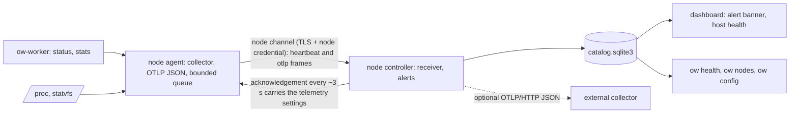

# Node telemetry and fleet health

Every runner's node agent reports host, box and channel health to the controller
as OpenTelemetry (OTLP) data. The controller keeps the latest values and a short
event log per runner, raises alerts and can forward everything to any OTLP
collector. Settings live on the controller only. Shipped in v0.9.41; see
[ADR 0009](adr/0009-node-telemetry-otlp.md) for the decisions.

Before this, a runner whose node channel stopped reaching the controller stayed
"reconnecting" without telling anyone; operators noticed only when SSH to boxes
failed. Now the controller raises `node_offline` within `alerts.offline_after_s`.
`ow health` exits 1 while the alert is active. When the runner reconnects, it
reports why its channel dropped and how long it was down.



## Commands

Run these on the controller host, the same way you run `ow nodes`. Add `--local`
if the shell has a saved remote login.

```sh
ow health                      # JSON: alerts, per-runner telemetry and recent events; exit 1 on an alert
ow nodes                       # inventory, now with alerts and telemetry per runner
ow config list                 # every setting, typed, with the configuration version
ow config get telemetry.interval_s
ow config set telemetry.enabled false
ow config set telemetry.forward_endpoint http://127.0.0.1:4318
```

A check from cron or a systemd timer can use the exit status of `ow health`. Every
alert transition also writes one journal line on the controller:
`alert raised: node_offline node=…` or `alert cleared: …`. Journal-based alerting
(CloudWatch agent, Loki, …) can match on these lines.

On a remote CLI, `ow nodes` shows whether each runner advertises
`telemetry_v1`, so a deployment can check that every runner supports it.

## Settings (controller only)

Settings are stored in the controller's catalog (`settings` table). Every change
bumps `config_version` and adds a row to `config_changes` (key, value, time,
`SUDO_USER`/`USER`). The controller reads the settings on every acknowledgement
it sends a runner, about every 3 s. A change therefore reaches every connected
runner within seconds, with no redeploy and nothing set per runner.
Infrastructure code carries no telemetry setting.

| Key | Default | Range | Effect |
| --- | --- | --- | --- |
| `telemetry.enabled` | `true` | `true`, `false` | Runners collect and send telemetry; `false` also clears their queues. Alerts do not depend on it. |
| `telemetry.interval_s` | `15` | 5–300 | Seconds between metric samples on each runner. |
| `telemetry.forward_endpoint` | empty | `http(s)://host[:port][/path]` | OTLP/HTTP base URL to forward to (`/v1/metrics`, `/v1/logs` are appended). No user, password, query or fragment is accepted; secrets do not belong in settings. |
| `alerts.offline_after_s` | `60` | 15–86400 | Grace period before an offline runner raises `node_offline`. |
| `alerts.disk_low_gib` | `20` | 0–100000 | `disk_low` when a runner's free data-volume space is below this. |

## What runners report

All metrics use the OTLP JSON encoding (`ExportMetricsServiceRequest`). Names
follow the OpenTelemetry semantic conventions where they exist, otherwise `ow.*`.
Resource attributes: `service.name=ow-node-agent`, `service.version`,
`ow.node.id`, `host.arch`, `os.type`.

| Metric | Type, unit | Attributes | Source |
| --- | --- | --- | --- |
| `system.cpu.utilization` | gauge, 1 | – | `/proc/stat` delta (Linux) |
| `system.memory.limit` | gauge, By | – | `/proc/meminfo` MemTotal (Linux) |
| `system.memory.usage` | gauge, By | `system.memory.state` = used, available | `/proc/meminfo` (Linux) |
| `system.cpu.load_average.1m`, `.5m`, `.15m` | gauge | – | `getloadavg` |
| `system.filesystem.usage` | gauge, By | `system.filesystem.state` = used, free | `statvfs` of the data directory |
| `process.memory.usage` | gauge, By | `ow.process` = agent, worker | `VmRSS` (Linux) |
| `ow.box.running` | gauge | – | worker `stats` |
| `ow.box.memory.rss`, `ow.box.memory.pss` | gauge, By | `ow.box.id` | worker `stats`, at most 32 boxes (largest RSS) |
| `ow.node.channel.connects` | sum | – | acknowledged channel connections |
| `ow.node.channel.disconnects` | sum | `reason` | channel losses by class |
| `ow.node.channel.connect.duration` | gauge, ms | – | start of the attempt to first acknowledgement |
| `ow.node.operation.duration` | gauge, ms | `op` | last snapshot, hibernate, restore, fork, start, capture-push, capture-pull |
| `ow.node.operation.count` | sum | `op`, `outcome` | the same operations |
| `ow.node.jobs.active` | gauge | – | jobs the agent runs |
| `ow.node.worker.status.age` | gauge, s | – | age of the newest worker status (a stuck worker grows it) |
| `ow.telemetry.dropped` | sum | – | payloads dropped by the bounded queue or for size |

Events are OTLP log records (`ExportLogsServiceRequest`) with `event.name` and a
severity:

| Event | When | Attributes |
| --- | --- | --- |
| `ow.node.agent.started` | agent process start | `ow.version` |
| `ow.node.channel.disconnected` | first failure after the channel was up | `reason` |
| `ow.node.channel.reconnected` | first acknowledgement after a loss | `reason`, `attempts`, `downtime_s` |
| `ow.node.operation` | each timed operation | `op`, `outcome`, `duration_ms` |

The controller writes its own events into the same per-runner log:
- `ow.node.session.opened` and `ow.node.session.closed`, for sessions that stored
  at least one heartbeat. The close event carries `reason` = timeout, ping, auth,
  refused, invalid, superseded, store (the heartbeat could not be recorded),
  closed or controller_restart, plus `last_seen_unix_s`. The controller's journal
  line `node … session ended (…)` has the detail.

  A session that ends before any heartbeat is stored writes no event. It only
  updates the runner's latest close reason in `node_seen`, so a runner retrying
  every 2 s cannot flood the log.
- `ow.alert.raised` and `ow.alert.cleared`.

These events exist even when the runner cannot send anything.

Disconnect reasons are fixed classes: silent (no frame from the controller for
20 s), dns, connect, tls, auth, refused, worker, closed. Raw error text, host names, paths, box names, owners, commands and
environment never leave the runner. A box is named by its opaque worker ID
(`m-<24 hex>`). An older box whose worker ID may be a user-chosen name is sent
as a salted hash prefix (`h-<16 hex>`) instead. The salt is a random secret kept
privately in the runner's data directory (`telemetry-salt`), so a guessed name
cannot be matched.

## Alerts

| Alert | Condition | Notes |
| --- | --- | --- |
| `node_offline` | An enrolled runner that has connected before has stored no heartbeat for `alerts.offline_after_s`. | Includes the latest close reason and since when. The grace period counts from the last stored heartbeat, or from controller start if that is later, so a restart does not page for every runner. A runner that keeps reconnecting but fails before a heartbeat is accepted (refused protocol, no compatible worker) still goes offline. Unused invitations and revoked runners are skipped. |
| `disk_low` | An online runner's heartbeat `free_disk_bytes` is below `alerts.disk_low_gib`. | Uses the heartbeat, so it works with telemetry off. |

`node_offline` is the signal for a stuck reconnect: from the controller's side, a
runner whose channel never comes back is offline. The reconnect itself was
hardened in 0.9.40: the agent reconnects after 20 s without a frame from the
controller and reuses its last resolved addresses while DNS hangs (see
[multi-node](MULTINODE.md)). Telemetry reports those disconnects as
`reason=silent` and `reason=dns`.

Surfaces:
- `ow health` (exit status);
- `ow nodes`;
- the dashboard banner and the health line on each host, for the pool owner;
- the journal line on each transition;
- when forwarding, the `ow.node.up` and `ow.alert.active` series.

## Protocol and compatibility

- The agent adds `telemetry_v1: true` to its heartbeats. Old controllers store it and
  do nothing else.
- A new controller lists `telemetry-v1` in the `ready` acknowledgement's
  `extensions` and adds `"telemetry": {"enabled", "interval_s", "version"}`. Old
  agents read only `type`, `node`, `generation` and `extensions`, so they are
  unaffected.
- The agent sends telemetry only on a channel whose acknowledgement offered
  `telemetry-v1`: `{"type":"otlp","signal":"metrics"|"logs","body":{…}}`, at most
  28 KiB per frame (under the 32 KiB session limit). The flag resets on every
  connection, so a new agent never sends to an old controller.
- The controller handles `otlp` frames before heartbeat validation. They never keep
  a runner online. A session whose runner did not advertise `telemetry_v1` is
  closed if it sends one. More than 20 frames per 3 s tick are ignored.
- The controller validates every frame. It accepts only `system.*`, `process.*`
  and `ow.*` names, bounded counts and plain attribute values. It drops any
  claimed `ow.node.id` and sets the authenticated runner's ID instead.
- What it forwards is rebuilt from the validated fields only; anything else a
  runner sent is dropped. Refusals are logged with escaped text, so runner input
  cannot forge `alert …` journal lines.
- `ow host up` runs the same agent in-process and reports the controller host
  like any runner. A controller-only host reports no host metrics of its own.
- macOS runners send load, disk, channel and operation data; CPU, memory and
  process memory need `/proc`.

## Bounds and overhead

| Boundary | Limit |
| --- | --- |
| Runner queue | 64 payloads; the oldest is dropped and counted |
| Frame | 28 KiB; a metric that cannot fit is dropped and counted |
| Per-box series | 32 boxes |
| Frames per controller session | 20 per 3 s tick; agents send at most 5 per second |
| Stored per runner | latest summary (≤ 256 series) and 200 events |
| Forwarder | 64 queued payloads, one attempt each, 5 s timeout, no redirects |

Each event keeps the time it happened on the runner. A disconnect queued during
an outage is stored and listed at its own time, not when it arrived. A
timestamp more than 5 minutes ahead or a week behind the controller's clock
falls back to the arrival time.

While the channel is down, events and samples wait in the queue (a runner that
reconnects reports why it went down). Then the oldest are dropped and counted
in `ow.telemetry.dropped`. Collection reads `/proc` and `statvfs` once per
interval and asks the worker for `stats` with a 5 s limit. A busy worker skips
one round of box metrics. The controller writes telemetry and events from
blocking threads, never on the async threads that answer runners. The settings
it puts in each acknowledgement come from one query inside the heartbeat's
existing database step.

## Forwarding to a collector

`telemetry.forward_endpoint` makes the controller post each runner's payload
(stamped with the authenticated `ow.node.id`) and its own series to
`<endpoint>/v1/metrics` and `<endpoint>/v1/logs` (OTLP/HTTP, JSON). The
controller's own series:

| Series | Value |
| --- | --- |
| `ow.node.up` | 1 or 0 per runner |
| `ow.alert.active` | 1 or 0 for each runner and alert kind (`ow.alert.kind`, `ow.node.id`); a cleared alert reports 0 |
| `ow.node.heartbeat.age` | seconds since each runner's last stored heartbeat |
| `ow.telemetry.forward.dropped` | payloads the forwarder dropped |

Any OpenTelemetry Collector with an `otlp` receiver on port 4318 accepts this.
From there it can export to Prometheus, Grafana Cloud, Datadog and others. Point
it at a collector on the controller host or the tailnet. A collector that needs
credentials should get them from its own secret store, not from this setting.
The endpoint is re-read every 3 s.

## Research notes

Facts from upstream documentation:
- **Firecracker metrics.** `PUT /metrics` or `--metrics-path` writes one JSON
  line of counters per flush to a file or named pipe:
  - per-VM `vcpu`, `block` and `block_<drive>`, `net` and `net_<iface>`,
    `balloon`, `vsock`, `uart`, `latencies_us`, `api_server`, `seccomp`,
    `signals`, `vmm`;
  - flushed every 60 s, or on a `FlushMetrics` action;
  - units are encoded in the field names.

  The metrics configuration is not part of the guest configuration, is not
  restored from a snapshot, and must be set before boot or snapshot load.
  Firecracker's logger (`PUT /logger`) is the same kind of pre-boot setting.
  Open Workspaces starts Firecracker with `--log-path /proc/self/fd/2 --level
  Warning` and configures no metrics path (`crates/ow-core/src/vm.rs`).
- **Rust OpenTelemetry.**
  - The metrics and logs SDKs are stable from 0.30/0.29; traces are beta.
  - The OTLP exporter for metrics and logs became stable in `opentelemetry-otlp`
    0.33.1, released 2026-10-09.
  - That crate pulls reqwest 0.13 (we use 0.12), prost and optionally tonic, and
    is pre-1.0 with lockstep minor versions.
- **OTLP's JSON encoding is stable.** It is the proto3 JSON mapping: 64-bit
  integers and nanosecond timestamps as decimal strings, enum values as numbers.

Decided here (ADR 0009):
- The OTLP JSON is hand-written with `serde_json`, about 200 lines, with no new
  dependencies.
- Telemetry travels on the node channel, which already carries TLS and the node
  credential.
- Firecracker per-VM metrics are deferred. Wiring them needs a worker change
  (class-2 upgrade) and reconfiguration on every resume.

Not done and still open:
- Firecracker per-VM device counters and per-box CPU/network counters. Both are
  worker changes.
- Metric history beyond the latest summary, and traces.
- Webhook alerts, which need a secret URL.
- Remote `ow config` through the dashboard API.

## Verification

Run with `cargo test -p ow --bin ow telemetry` (Linux for the protocol tests):
- **OTLP encoding:** string `timeUnixNano`/`asInt`, gauge and cumulative
  monotonic sum, and the 28 KiB split.
- **Queue bounds and negotiation:** the queue drops the oldest and counts it, and
  waits until the controller offers telemetry.
- **Channel transitions:** each one is counted once, with its reason class.
- **Parsers and box IDs:** the `/proc` parsers, and box-ID hashing of legacy names.
- **Settings:** validation, the version counter and the audit rows.
- **Receiver validation:** names, attributes, and stamping of the authenticated runner.
- **Alerts:** offline after the grace period, disk low, and that unused invitations
  and revoked runners are skipped.
- **Forwarder:** posts only once an endpoint is set.
- **Controller end to end:**
  - an unnegotiated `otlp` frame closes the session;
  - a negotiated frame is stored under the authenticated runner;
  - `ow config set` reaches the next acknowledgement.
- **Agent end to end** (against a stand-in controller and worker):
  - host, box and channel metrics are sent;
  - a dropped channel produces `disconnected` and `reconnected` events;
  - a legacy box name never leaves the runner.

The dashboard banner and host health line are covered by
`hosts.spec.mjs › fleet health shows node metrics and alerts` and
`hosts.spec.mjs › fleet health is hidden from other users`. That every rainy-devbox runner
advertises `telemetry_v1` is checked in the rollout after this release.
